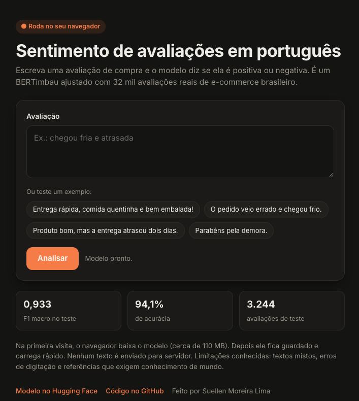
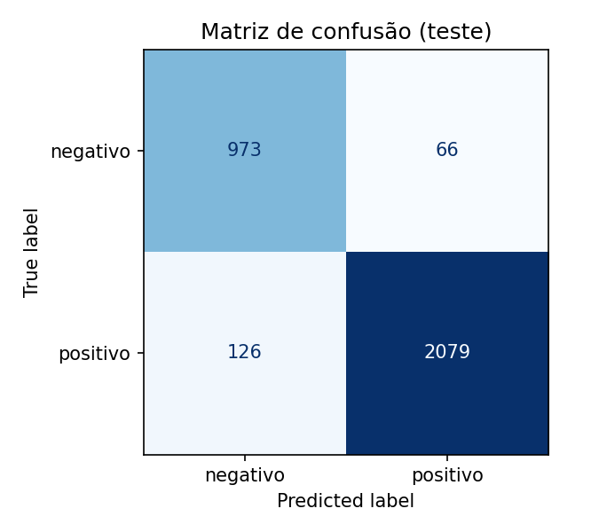

# Sentimento de avaliações em português com BERTimbau

Classificador que lê uma avaliação de compra em português e diz se ela é **positiva** ou **negativa**. Treinado com 32 mil comentários reais de e-commerce brasileiro, chega a **0,933 de F1 macro** no conjunto de teste.

**[Testar a demo](https://huggingface.co/spaces/suellenlima/sentimento-reviews-ptbr)** · **[Modelo no Hugging Face](https://huggingface.co/suellenlima/bertimbau-sentimento-reviews-ptbr)**

[](https://colab.research.google.com/github/SuellenMoreiraLima/sentimento-reviews-ptbr/blob/main/notebooks/02_treino_sentimento.ipynb)



## Resultados

| Métrica (teste) | Valor |
|---|---|
| F1 macro | 0.933 |
| Acurácia | 0.941 |
| Exemplos de teste | 3,244 |

| Classe | Precisão | Recall | F1 |
|---|---|---|---|
| negativo | 0.885 | 0.936 | 0.910 |
| positivo | 0.969 | 0.943 | 0.956 |

O modelo encontra **93,6% das avaliações negativas** (recall), que são as mais importantes para identificar clientes insatisfeitos.



### Exemplos

| Texto | Previsão | Confiança |
|---|---|---|
| Entrega rápida, comida quentinha! | positivo | 99,8% |
| Pedido veio errado e frio. | negativo | 97,5% |
| Parabéns pela demora. | negativo | 89,2% |

O modelo identificou a ironia em "Parabéns pela demora", mas com confiança menor que nos outros casos, já que "parabéns" costuma aparecer em elogios.

## Como funciona

```
Avaliações Olist ─► limpeza e rótulos ─► divisão 80/10/10 ─► fine-tuning BERTimbau ─► avaliação ─► Hugging Face Hub ─► ONNX int8 ─► demo no navegador
```

1. **Dados:** 99.224 avaliações públicas da [Olist](https://www.kaggle.com/datasets/olistbr/brazilian-ecommerce). Depois de manter só as que têm comentário, descartar a nota 3 e remover duplicatas, ficaram **32.433** (68% positivas, 32% negativas).
2. **Rótulos:** notas 1-2 viram *negativo*, 4-5 viram *positivo*. O modelo lê **apenas o texto**; a nota serve só como gabarito durante o treino.
3. **Modelo:** [BERTimbau base](https://huggingface.co/neuralmind/bert-base-portuguese-cased), um BERT pré-treinado em português, com fine-tuning para classificação binária.
4. **Divisão:** 25.946 para treino, 3.243 para validação e 3.244 para teste, estratificada.
5. **Demo:** o modelo é convertido para ONNX e quantizado em int8 (de ~436 MB para ~110 MB). A página da demo roda essa versão **direto no navegador** com [Transformers.js](https://huggingface.co/docs/transformers.js), sem servidor.

## Decisões técnicas

| Decisão | Escolha | Por quê |
|---|---|---|
| Modelo base | BERTimbau base | Pré-treinado em português; cabe na GPU gratuita do Colab |
| Abordagem | Fine-tuning | Aproveita o que o modelo já sabe de português; treinar do zero exigiria milhões de exemplos |
| Por que não um LLM? | Modelo pequeno | Em milhões de avaliações por dia, um modelo de 110M parâmetros é muito mais barato e rápido |
| Rótulos | Nota da avaliação (rotulagem fraca) | Evita rotular milhares de textos à mão; o custo é algum ruído, analisado abaixo |
| Nota 3 | Descartada | Na exploração, mistura elogio e reclamação ("Gostei, bom tamanho" e "entrega deficiente") |
| Métrica | F1 macro | As classes são desbalanceadas (68/32); a acurácia esconderia um modelo ruim na classe negativa |
| Divisão | Estratificada, sem duplicatas | Mesma proporção de classes em cada parte e sem vazamento de textos repetidos |
| Demo | Static Space + Transformers.js | Grátis e sem servidor: o modelo roda no navegador, e nenhum texto sai do computador do usuário. Spaces com servidor (Gradio) exigem plano pago |
| Formato da demo | ONNX quantizado em int8 | Arquivo ~4x menor (download mais rápido no navegador), conferido contra o modelo original antes de publicar |

Hiperparâmetros: learning rate 2e-5, 3 épocas, batch 32, `max_length` 128, warmup 10%, weight decay 0.01, seed 42. Treino de cerca de 6 minutos numa GPU T4.

## Treino por época

| Época | Loss de treino | Loss de validação | F1 macro (validação) |
|---|---|---|---|
| 1 | 0.172 | 0.162 | 0.929 |
| 2 | 0.119 | 0.167 | **0.933** |
| 3 | 0.089 | 0.193 | 0.931 |

Na época 3, o loss de treino continuou caindo enquanto o de validação subiu: um sinal de **overfitting** (o modelo começou a decorar o treino). Por isso o treino guarda automaticamente a melhor época pela F1 de validação, que foi a **segunda**.

## Análise de erros

O modelo errou 192 de 3.244 exemplos de teste (5,9%). Li os 20 erros em que ele estava mais confiante:

| Tipo de erro | Quantidade | Exemplo |
|---|---|---|
| Rótulo errado no dado (nota não bate com o texto) | 11 | "Boneca linda!!! e a entrega no prazo, muito satisfeita." com nota negativa |
| Texto misto (elogio + reclamação) | 6 | "Relógio muuuuito pequeno, ainda bem que sou magra. Ficou legal" |
| Texto vago | 1 | "Loja razuavel" |
| Erro real do modelo | 2 | "produto de ma qualidade" → previu positivo |

**Mais da metade dos erros "confiantes" são, na verdade, acertos do modelo:** o rótulo derivado da nota é que estava errado. O desempenho real provavelmente é maior que o medido.

Os dois erros reais são instrutivos:
- **"produto de ma qualidade":** sem o acento em "má", o modelo provavelmente se apoiou em "qualidade", que costuma aparecer em elogios.
- **"O que era para ser o presente de natal, chegou depois de reis":** entender a reclamação exige saber que o Dia de Reis vem depois do Natal. É conhecimento de mundo que um modelo pequeno não tem, e um LLM provavelmente acertaria.

## Limitações

- Treinado em avaliações de e-commerce, não de delivery de comida.
- Rótulos derivados da nota contêm ruído.
- Dificuldade com textos mistos, erros de digitação e referências que exigem conhecimento de mundo.
- Não classifica sentimento neutro.

## Estrutura

```
├── notebooks/
│   ├── 01_exploracao.ipynb          # análise do dataset e justificativa das decisões
│   ├── 02_treino_sentimento.ipynb   # preparação, treino, avaliação e publicação
│   └── 03_exportar_onnx.ipynb       # conversão para ONNX int8, usada pela demo
├── app/                             # demo: página estática com Transformers.js (Hugging Face Space)
├── images/                          # matriz de confusão e print da demo
└── resultados/                      # métricas, erros do teste e model card
```

## Como reproduzir

| Notebook | Abrir |
|---|---|
| 01 · Exploração dos dados | [](https://colab.research.google.com/github/SuellenMoreiraLima/sentimento-reviews-ptbr/blob/main/notebooks/01_exploracao.ipynb) |
| 02 · Treino, avaliação e publicação | [](https://colab.research.google.com/github/SuellenMoreiraLima/sentimento-reviews-ptbr/blob/main/notebooks/02_treino_sentimento.ipynb) |
| 03 · Versão ONNX para a demo | [](https://colab.research.google.com/github/SuellenMoreiraLima/sentimento-reviews-ptbr/blob/main/notebooks/03_exportar_onnx.ipynb) |

1. Abra o notebook 02 no Colab pelo botão acima e ative a GPU T4 (*Runtime → Change runtime type*).
2. Salve um token *Write* do Hugging Face nos Secrets do Colab como `HF_TOKEN` (e, opcionalmente, `KAGGLE_USERNAME` e `KAGGLE_KEY`).
3. Ajuste `HUB_REPO` na célula de configuração e rode tudo (*Runtime → Run all*).

Para a demo: rode o notebook 03 (gera e publica a versão ONNX), crie um Space **Static** e envie os arquivos da pasta `app/`.

## Próximos passos

- Rotular uma amostra à mão para medir o ruído dos rótulos.
- Testar learning rate 5e-5 e 3 classes (incluindo neutro) como experimentos.
- Classificar também o **tema** da avaliação (entrega, produto, atendimento, preço).
- Comparar com um LLM em acurácia, custo e latência, especialmente nos casos que exigem conhecimento de mundo.
- Deploy da inferência em AWS Lambda com Docker, como API.

## Transparência

Desenvolvido com o auxílio do Claude (Anthropic) como assistente de código e de estudo. Execução, análise dos resultados e decisões finais são minhas.

## Licença

Código sob licença [MIT](LICENSE). O dataset da Olist é distribuído sob CC BY-NC-SA 4.0.
